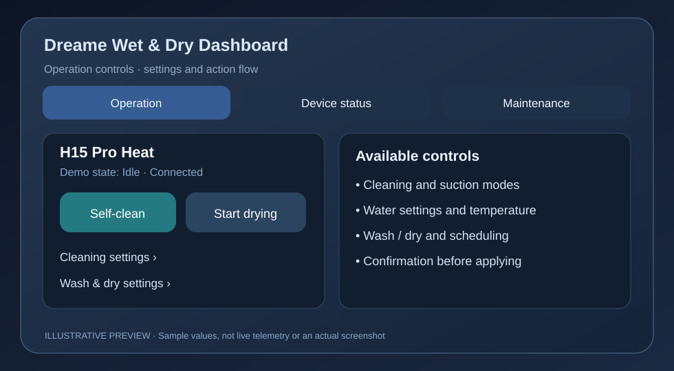
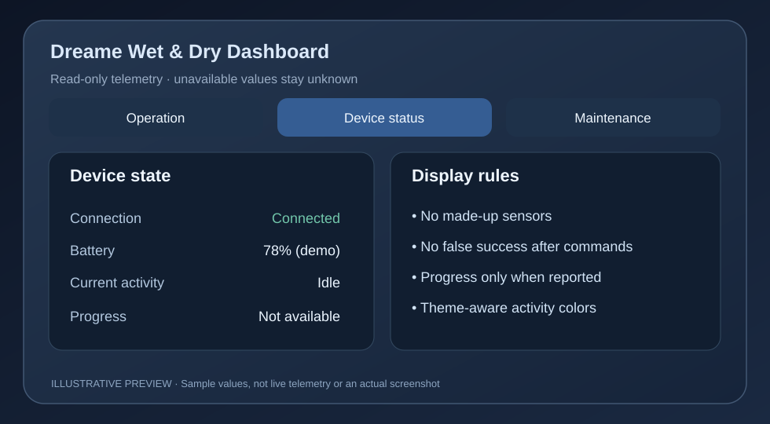
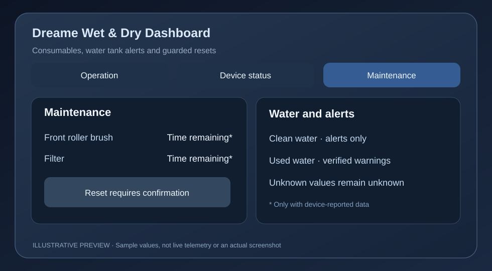

# Dreame Wet & Dry Dashboard
**A standalone Home Assistant Lovelace card for supported Dreame wet & dry vacuum entities.**

> **PRE-RELEASE REVIEW — not an official public release.** This folder is a self-contained *candidate* for a future dedicated `dreame-device-card` GitHub repository (HACS category: **Dashboard**). Do **not** register this integration repository as a Dashboard repository in HACS: it is currently an Integration repo. This card is not affiliated with Dreame.


*Illustrative preview, not a capture of Home Assistant or real device telemetry. Values and layout are examples.*

## What the dashboard does

The card shows existing Home Assistant entities belonging to the selected Dreame device. It does **not** query the Dreame cloud, create sensors or reinterpret unknown H15 values. It also does not install or replace the underlying integration.

| Screen | What you can see / do |
| --- | --- |
| **Operation** | Start/stop supported self-cleaning or drying, review cleaning/water/suction choices, and open device settings. Select options before confirming; offline controls are disabled. Only controls exposed by the installed integration are available. |
| **Device status** | Read battery level, connection, charging, current work state, cleaning and drying progress (when actually reported), and available working statistics. Unknown data is not shown as zero or as a successful action. |
| **Maintenance** | Inspect reported water-tank warnings, filter and roller-brush life, service alerts, and reset controls. Resets require an explicit confirmation and do not fake a successful reset before state feedback arrives. |

### Operation


The first tab prioritizes daily operation. Cleaning/wash/dry settings are grouped to avoid a long control panel. Unsupported and unavailable actions are not offered as working capabilities.

### Device status



Status is driven by Home Assistant state and the integration's device/entity registry. Battery, progress, and activity are only rendered from data supplied by the installed device integration. The visual style follows Home Assistant light/dark theme variables.

### Maintenance



The maintenance tab covers filter and front roller-brush lifetime, water warnings, and faults. A remaining **percentage** is shown only when a valid device maximum is known. Missing tank-level telemetry is **not** inferred from the absence of an alarm. Reset actions have a confirmation step.

## Compatibility and limitations

- The card is intended for models represented by the [Dreame Wet & Dry integration](https://github.com/matanmesika/dreame-wet-dry-vacuum-home-assistant). The visual editor provides **H14**, **H15**, or automatic model selection.
- **H15 Pro Heat** (`dreame.hold.w2449e`) mapping is incomplete and still experimental. Some write actions, alert meanings, and readbacks require physical confirmation.
- Existing H14 mappings are preserved by the *integration*; the card does not change integration-side mappings.
- Device/entity registry access is needed for automatic selection; individual entities can be explicitly configured in the editor.
- No phone/browser/live Home Assistant acceptance test has been recorded for this release candidate. A green unit-test run is not equivalent to an end-to-end test.

## Installation — preview from this branch (manual)

1. Install and configure the supported Dreame integration first; for H15, use the compatible experimental development version **only if you are knowingly testing it**.
2. Copy `dist/dreame-device-card.js` from this candidate to `<config>/www/dreame-device-card.js`.
3. In Home Assistant go to **Settings → Dashboards → ⋮ → Resources** and add `/local/dreame-device-card.js` as a **JavaScript module**.
4. Refresh the browser or restart the Home Assistant companion app if the card was already loaded.
5. Add a manual card with the following YAML:

```yaml
type: custom:dreame-device-card
model: H15
language: en
title: H15 Pro Heat
# entity: sensor.YOUR_REAL_DREAME_ENTITY  # Optional, do not invent IDs
```

For H14 set `model: H14`; for automatic matching omit `model`. You can set `language: he` for Hebrew. A `device_id` or `entity` from the **actual** device registry is helpful when more than one device is present. A dashboard example is in [examples/dashboard.yaml](examples/dashboard.yaml).

**Future HACS Dashboard installation:** Once the content of this folder is moved to a dedicated repository called `dreame-device-card`, HACS can install the JavaScript from `dist/` under `www/community/`. At that point, add that new repository as HACS category **Dashboard** and use its `/hacsfiles/dreame-device-card/dreame-device-card.js` resource. **This path does not work from the present integration repository as a dashboard install.**

## Quality and release policy

```sh
node --check dist/dreame-device-card.js
node --test tests/test_device_card.cjs
```

- The dashboard implementation is identical to the `www/dreame-device-card.js` file in the source development branch; the test runner was adjusted to target `dist/`.
- PR checks should pass before promotion.
- Review model selection, English/Hebrew layouts, the three tabs, iOS scroll handling, service command safety, and the maintenance reset dialog on a running Home Assistant.
- The `docs/images/*.svg` files are **illustrative previews**, not screenshots of a real system; substitute genuine screenshots after manual acceptance tests.

## Privacy, support and contribution

The card runs within Home Assistant and uses the supplied `hass` state and service methods; it does not itself send credentials or telemetry to a separate cloud API. The underlying integration is a separate project and may communicate with Dreame's cloud. Do not include personal credentials or device identifiers in screenshots or issue reports. The initial preparation is tracked in the [source integration repository](https://github.com/matanmesika/dreame-wet-dry-vacuum-home-assistant).

---

## עברית — בקצרה

זהו כרטיס דשבורד ל־Home Assistant המיועד למכשירי Dreame Wet & Dry נתמכים, עם **שלוש לשוניות: תפעול, מצב המכשיר ותחזוקה**. הכרטיס משתמש בישויות האמיתיות של האינטגרציה; הוא אינו ממציא חיישנים ואינו משנה את מיפויי המכשיר. ניתן לבחור `language: he`, ואת דגם H14 או H15 בעורך.

**חשוב:** המיפוי של H15 עדיין ניסיוני וחלקו דורש אימות מול מכשיר אמיתי. התמונות לעיל הן המחשה בלבד, ולא צילומי מסך של המערכת. הכרטיס עדיין בשלב הכנה לפרסום ואין לו גרסת Release ציבורית.
